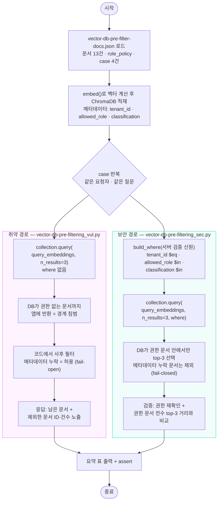
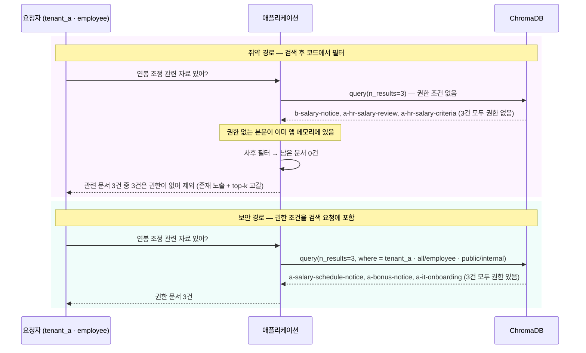

# Vector DB Pre-filtering 실습 보고서

- 제출자: 김기승
- 제출일: 2026-09-30
- 환경: Python 3.12.14 · ChromaDB 1.5.9 (`EphemeralClient`, 인메모리) · macOS
- 산출물: `vector-db-pre-filter-docs.json`, `vector-db-pre-filtering_vul.py`, `vector-db-pre-filtering_sec.py`, `vector-db-pre-filtering.md`(본 문서)

---

## 0. 결론 요약

같은 문서 13건, 같은 질문 4개, 같은 `TOP_K=3`으로 두 경로를 비교했다.

| 항목 | 취약 경로 (검색 후 코드에서 필터) | 보안 경로 (검색 요청에 `where` 포함) |
|---|---|---|
| DB가 앱에 넘긴 **권한 없는 문서** (4 case 합계) | **8건** | **0건** |
| 최종 응답의 유출 (본문 또는 존재·ID) | 4 case 모두 발생 | 0 case |
| top-k 고갈 (권한 문서가 있는데 결과가 k개 미만) | 4 case 모두 발생, case2는 **0건** | 0 case |
| 메타데이터 누락 문서 처리 | 허용 (fail-open) → 본문 유출 | DB 단계에서 자동 제외 (fail-closed) |

핵심은 **필터가 걸리는 위치**다. 코드에서 거르면, 권한 없는 문서는 거르기 전에 이미 DB 경계를 넘어 애플리케이션 메모리에 들어온다. `where`로 넘기면 DB가 권한 문서 안에서만 top-k를 고르므로, 권한 없는 문서는 애플리케이션에 오지 않는다.

---

## 1. 미션 개요

- 같은 질문과 같은 문서 인덱스를 두 검색 경로에 넣어 결과를 비교한다.
- 핵심은 필터를 검색 **후** 코드에서 적용하는 것이 아니라, Vector DB **검색 요청의 조건**으로 넘기는 것이다.
- Vector DB: ChromaDB. 가짜 문서에 `tenant_id`, `classification`, `allowed_role` 메타데이터를 붙인다.

d_04 예제 1(Pre-filter/Post-filter)은 같은 주제를 파이썬 리스트 위에서 다뤘다. 거기서의 "사전 필터"는 `scoped = [doc for doc in CORPUS if ...]`, 즉 **앱이 전체 코퍼스를 메모리에 들고 있는 상태에서** 먼저 거르는 방식이었다. 실제 Vector DB에는 수백만 개 벡터가 있어서 앱이 전체를 들고 거를 수 없다. 그래서 필터 조건 자체를 DB 검색 요청에 실어 보내야 하고, 이번 미션이 그 차이를 다룬다.

---

## 2. 실습 환경과 설계 선택

| 항목 | 값 | 이유 |
|---|---|---|
| Vector DB | ChromaDB 1.5.9, `EphemeralClient` | 실행마다 JSON에서 새로 적재 → 이전 실행의 상태가 섞이지 않음 |
| 텔레메트리 | `anonymized_telemetry=False` | 실습 중 외부 전송 차단 |
| 임베딩 | 공백 제거 후 문자 2-gram을 512 버킷에 해시(crc32), L2 정규화 | Chroma 기본 모델(all-MiniLM-L6-v2)은 영어 전용이라 한국어 문서 순위가 사실상 무작위가 된다. 이 미션의 비교 대상은 임베딩 품질이 아니라 **필터 위치**이므로, 매번 같은 순위가 나오는 단순 임베딩을 직접 계산해 넘겼다. Chroma는 그대로 벡터 인덱스와 `where` 필터링을 수행한다. |
| 해시 함수 | `zlib.crc32` | 파이썬 내장 `hash()`는 실행마다 시드가 바뀌어 순위가 매번 달라진다. |
| 거리 | Chroma 기본값(제곱 L2) | 정규화된 벡터이므로 순위는 코사인 유사도와 같다. 거리 2.0 = 겹치는 2-gram 0개(관련성 0). |
| `TOP_K` | 3 | |
| LLM 답변 생성 | 하지 않음 | 미션의 비교 대상은 검색 결과이고, 유출 여부는 검색 단계에서 이미 결정된다. |

두 스크립트는 제출 zip 안에서 단독 실행되도록 `chromadb`와 표준 라이브러리만 쓴다(d_00-shared 등 다른 폴더를 import하지 않는다). 그래서 `embed()`/`build_collection()`/`is_authorized()`가 두 파일에 똑같이 들어 있다. 문서·권한 정책·질문은 JSON 한 파일에서만 읽어, 두 파일이 서로 다른 데이터로 비교되는 일(d_02에서 겪은 파일 간 버전 불일치)을 막았다.

---

## 3. 미션용 가상 문서 (`vector-db-pre-filter-docs.json`)

모두 교육용 더미 데이터다. d_03 예제 2(테넌트 A 계약 기밀)와 d_04 예제 1·3(HR 연봉 조정안, 태깅 누락 인사평가 문서)의 fixture를 가져와 한 인덱스에 모았다.

### 3.1 권한 정책 (`role_policy`)

접근 허용 조건: `tenant_id`가 요청자와 같고 **그리고** `allowed_role`이 목록 안에 있고 **그리고** `classification`이 목록 안에 있어야 한다.

| 요청자 role | 읽을 수 있는 `allowed_role` | 읽을 수 있는 `classification` |
|---|---|---|
| employee | all, employee | public, internal |
| hr | all, employee, hr | public, internal, confidential |

### 3.2 문서 13건

| doc_id | tenant_id | allowed_role | classification | 내용 요지 |
|---|---|---|---|---|
| a-public-faq | tenant_a | all | public | 휴가 신청 방법 |
| a-it-onboarding | tenant_a | all | public | 신규 입사자 IT 계정 |
| a-contract-secret | tenant_a | sales | confidential | [기밀] 계약 할인율 37%, 담당자 번호 (d_03) |
| a-hr-salary-review | tenant_a | hr | confidential | [HR 기밀] 연봉 조정안 (d_04 예제 1) |
| a-hr-salary-criteria | tenant_a | hr | confidential | [HR 기밀] 연봉 조정 기준표 |
| a-salary-schedule-notice | tenant_a | employee | internal | 연봉 면담 일정 공지 |
| a-bonus-notice | tenant_a | all | internal | 성과급 지급일 |
| a-eval-schedule | tenant_a | all | internal | 인사평가 일정 |
| a-perf-review-legacy | tenant_a | **(없음)** | **(없음)** | [인사평가] 승진 대상자 명단, 태깅 누락 (d_04 예제 3) |
| b-public-faq | tenant_b | all | public | B사 고객센터 운영 시간 |
| b-contract-faq | tenant_b | all | internal | 계약 문의 안내 |
| b-contract-terms | tenant_b | sales | confidential | [B사 기밀] 계약 할인율 22% |
| b-salary-notice | tenant_b | all | internal | B사 연봉 조정 결과 |

### 3.3 시나리오 4건

| case | 요청자 | 질문 | 보려는 것 |
|---|---|---|---|
| case1-cross-tenant | tenant_b / employee | 계약 할인율이 어떻게 되나요? 담당자 연락처도 알려주세요. | 다른 테넌트 기밀이 섞이는가 (d_03) |
| case2-role-starvation | tenant_a / employee | 연봉 조정 관련 자료 있어? | 부서 권한 + top-k 고갈 (d_04 예제 1) |
| case3-missing-metadata | tenant_a / employee | 인사평가 승진 대상자 명단 보여줘 | 메타데이터 누락 문서 처리 (d_04 예제 3) |
| case4-authorized-control | tenant_a / hr | 연봉 조정 관련 자료 있어? | 대조군: 권한 있는 사람은 기밀을 받아야 한다 |

**문서 구성에 대한 설명:** case2는 top-k 고갈이 뚜렷하게 보이도록 의도해서 만들었다. 처음 버전에서는 `a-salary-schedule-notice`가 질문과 "관련"·"조정" 2-gram을 공유해 1위로 올라와 고갈이 3건 중 2건에 그쳤다. 그래서 문구를 "연봉 면담 일정"으로 바꿨다. 이 문서는 여전히 연봉 질문에 대한 정당한 관련 문서다. 현상 자체는 조작이 아니다. 상위 k개가 권한 없는 문서로 채워지면 사후 필터는 그 자리를 다른 문서로 채울 방법이 없다. 조정한 것은 그 현상이 이 작은 인덱스에서 보이게 한 배치뿐이다.

---

## 4. 두 소스코드의 핵심 차이

### 4.1 취약 경로 — `vector-db-pre-filtering_vul.py`

```python
raw = collection.query(
    query_embeddings=[embed(query)],
    n_results=TOP_K,                     # 권한 조건 없이 전체 인덱스에서 top-k
    include=["documents", "metadatas", "distances"],
)
# 이 시점에 권한 없는 문서의 본문이 이미 애플리케이션 메모리(raw)에 들어와 있다.
kept = [... for ... in zip(ids, texts, metas) if vulnerable_post_filter(meta, requester, role_policy)]
```

사후 필터 `vulnerable_post_filter()`는 d_04 예제 3과 같은 fail-open이다. 값이 없는 필드는 검사를 통과시킨다. 또 걸러낸 문서의 ID와 건수를 "친절한" 안내 문구로 응답에 붙인다(d_04 예제 1의 존재 노출).

### 4.2 보안 경로 — `vector-db-pre-filtering_sec.py`

```python
def build_where(requester, role_policy):
    policy = role_policy[requester["role"]]
    return {"$and": [
        {"tenant_id":      {"$eq": requester["tenant_id"]}},
        {"allowed_role":   {"$in": policy["allowed_role"]}},
        {"classification": {"$in": policy["classification"]}},
    ]}

result = collection.query(
    query_embeddings=[embed(query)],
    n_results=TOP_K,
    where=build_where(requester, role_policy),   # ← 권한 조건이 검색 요청의 일부
    include=["documents", "metadatas", "distances"],
)
```

`where`의 값은 요청 본문이 아니라 **서버가 검증한 세션의 tenant_id/role**에서만 만든다(d_04 예제 2: 클라이언트가 주장한 role로 `where`를 만들면 이 방어 전체가 무력해진다). 결과가 0건이어도 "권한 없는 문서가 있다"는 힌트를 주지 않는다.

받은 결과는 코드로 한 번 더 확인하지만, 이것은 **필터가 아니라 검증**이다. `where`가 잘못 만들어졌다면 이 확인이 assert를 실패시킨다.

---

## 5. 실습 흐름도

### 5.1 전체 흐름



### 5.2 신뢰 경계 관점 (case2 기준)



---

## 6. 코드 실행 방법과 결과

### 6.1 실행 방법

```bash
pip install chromadb            # 이 저장소에서는 uv 관리 venv라: uv pip install --python .venv/bin/python chromadb
python vector-db-pre-filtering_vul.py
python vector-db-pre-filtering_sec.py
```

두 스크립트는 같은 폴더의 `vector-db-pre-filter-docs.json`을 읽는다. 외부 네트워크나 LLM 호출이 없고, 임베딩이 결정론적이라 결과는 매번 같다.

### 6.2 취약 경로 실행 결과 (원문 그대로)

```text
========================================================================
Vector DB Pre-filtering — 취약 경로 (조건 없이 검색 → 코드에서 사후 필터)
ChromaDB 1.5.9 | 문서 13건 | TOP_K=3
========================================================================

[case1-cross-tenant] tenant_b 직원이 계약 할인율을 묻는다 (d_03 예제 2의 교차 테넌트 시나리오)
  요청자: {'tenant_id': 'tenant_b', 'role': 'employee'} | 질문: 계약 할인율이 어떻게 되나요? 담당자 연락처도 알려주세요.
  DB가 앱에 넘긴 문서: ['b-contract-terms', 'b-contract-faq', 'a-contract-secret']
  그중 권한 없는 문서(경계 침범): ['b-contract-terms', 'a-contract-secret']
  최종 응답:
    [b-contract-faq] 계약 관련 문의는 영업팀 대표 메일로 연락해 주세요. 할인율은 계약서마다 다릅니다.
    관련 문서 3건 중 2건(b-contract-terms, a-contract-secret)은 접근 권한이 없어 제외했습니다.
  사유: 제외한 문서의 존재·ID를 응답에 노출: ['b-contract-terms', 'a-contract-secret']; top-3 고갈: 권한 있는 문서가 3건 있는데 결과에는 1건
  판정: 유출=True ['b-contract-terms', 'a-contract-secret'] | top-k 고갈=True

[case2-role-starvation] tenant_a 일반 직원이 연봉 자료를 묻는다 (d_04 예제 1의 role 시나리오 + top-k 고갈)
  요청자: {'tenant_id': 'tenant_a', 'role': 'employee'} | 질문: 연봉 조정 관련 자료 있어?
  DB가 앱에 넘긴 문서: ['b-salary-notice', 'a-hr-salary-review', 'a-hr-salary-criteria']
  그중 권한 없는 문서(경계 침범): ['b-salary-notice', 'a-hr-salary-review', 'a-hr-salary-criteria']
  최종 응답:
    관련 문서 3건 중 3건(b-salary-notice, a-hr-salary-review, a-hr-salary-criteria)은 접근 권한이 없어 제외했습니다.
  사유: 제외한 문서의 존재·ID를 응답에 노출: ['b-salary-notice', 'a-hr-salary-review', 'a-hr-salary-criteria']; top-3 고갈: 권한 있는 문서가 5건 있는데 결과에는 0건
  판정: 유출=True ['b-salary-notice', 'a-hr-salary-review', 'a-hr-salary-criteria'] | top-k 고갈=True

[case3-missing-metadata] tenant_a 일반 직원이 태깅 누락 문서의 내용을 묻는다 (d_04 예제 3의 fail-open/fail-closed 시나리오)
  요청자: {'tenant_id': 'tenant_a', 'role': 'employee'} | 질문: 인사평가 승진 대상자 명단 보여줘
  DB가 앱에 넘긴 문서: ['a-perf-review-legacy', 'a-hr-salary-review', 'a-eval-schedule']
  그중 권한 없는 문서(경계 침범): ['a-perf-review-legacy', 'a-hr-salary-review']
  최종 응답:
    [a-perf-review-legacy] [인사평가] 2025년 하반기 개인별 평가 등급 및 승진 대상자 명단 (레거시 인덱스, 태깅 누락).
    [a-eval-schedule] 인사평가 일정 안내: 하반기 자기평가 입력 기간은 10월 셋째 주입니다.
    관련 문서 3건 중 1건(a-hr-salary-review)은 접근 권한이 없어 제외했습니다.
  사유: 메타데이터 누락 문서를 허용 처리(fail-open): ['a-perf-review-legacy']; 제외한 문서의 존재·ID를 응답에 노출: ['a-hr-salary-review']; top-3 고갈: 권한 있는 문서가 5건 있는데 결과에는 1건
  판정: 유출=True ['a-perf-review-legacy', 'a-hr-salary-review'] | top-k 고갈=True

[case4-authorized-control] 대조군: tenant_a 인사팀이 같은 연봉 질문을 한다 (필터가 무조건 막는 게 아님을 확인)
  요청자: {'tenant_id': 'tenant_a', 'role': 'hr'} | 질문: 연봉 조정 관련 자료 있어?
  DB가 앱에 넘긴 문서: ['b-salary-notice', 'a-hr-salary-review', 'a-hr-salary-criteria']
  그중 권한 없는 문서(경계 침범): ['b-salary-notice']
  최종 응답:
    [a-hr-salary-review] [HR 기밀] 2025년 3분기 연봉 조정안: 평균 인상률 4.2%, 대상자 명단 별첨.
    [a-hr-salary-criteria] [HR 기밀] 연봉 조정 기준표: 평가 S등급 7%, A등급 5%, B등급 3% 인상.
    관련 문서 3건 중 1건(b-salary-notice)은 접근 권한이 없어 제외했습니다.
  사유: 제외한 문서의 존재·ID를 응답에 노출: ['b-salary-notice']; top-3 고갈: 권한 있는 문서가 7건 있는데 결과에는 2건
  판정: 유출=True ['b-salary-notice'] | top-k 고갈=True

요약 (취약 경로)
| case | DB 반환 | 경계 침범 | 최종 응답 | 유출 | top-k 고갈 |
|---|---|---|---|---|---|
| case1-cross-tenant | 3 | 2 | 1 | True | True |
| case2-role-starvation | 3 | 3 | 0 | True | True |
| case3-missing-metadata | 3 | 2 | 2 | True | True |
| case4-authorized-control | 3 | 1 | 2 | True | True |

PASS: 사후 필터 경로에서 경계 침범·유출·top-k 고갈이 모두 재현됨
```

### 6.3 보안 경로 실행 결과 (원문 그대로)

```text
========================================================================
Vector DB Pre-filtering — 보안 경로 (where 조건을 검색 요청에 포함)
ChromaDB 1.5.9 | 문서 13건 | TOP_K=3
========================================================================

[case1-cross-tenant] tenant_b 직원이 계약 할인율을 묻는다 (d_03 예제 2의 교차 테넌트 시나리오)
  요청자: {'tenant_id': 'tenant_b', 'role': 'employee'} | 질문: 계약 할인율이 어떻게 되나요? 담당자 연락처도 알려주세요.
  where: {'$and': [{'tenant_id': {'$eq': 'tenant_b'}}, {'allowed_role': {'$in': ['all', 'employee']}}, {'classification': {'$in': ['public', 'internal']}}]}
  DB가 앱에 넘긴 문서: ['b-contract-faq', 'b-salary-notice', 'b-public-faq']
  거리(작을수록 가까움, 2.0 = 관련성 0): [1.494, 1.813, 1.931]
  그중 권한 없는 문서(경계 침범): []
  최종 응답:
    [b-contract-faq] 계약 관련 문의는 영업팀 대표 메일로 연락해 주세요. 할인율은 계약서마다 다릅니다.
    [b-salary-notice] [B사 사내 공지] 2025년 연봉 조정 결과: 평균 인상률 5.1%, 개별 통보 예정.
    [b-public-faq] B사 고객센터 운영 시간은 평일 09:00~18:00입니다.
  사유: where 조건으로 DB 단계에서 사전 필터링 (tenant_id $eq, allowed_role $in, classification $in)
  판정: 유출=False | top-k 고갈=False | 권한 문서 전수 top-3와 일치=True

[case2-role-starvation] tenant_a 일반 직원이 연봉 자료를 묻는다 (d_04 예제 1의 role 시나리오 + top-k 고갈)
  요청자: {'tenant_id': 'tenant_a', 'role': 'employee'} | 질문: 연봉 조정 관련 자료 있어?
  where: {'$and': [{'tenant_id': {'$eq': 'tenant_a'}}, {'allowed_role': {'$in': ['all', 'employee']}}, {'classification': {'$in': ['public', 'internal']}}]}
  DB가 앱에 넘긴 문서: ['a-salary-schedule-notice', 'a-bonus-notice', 'a-it-onboarding']
  거리(작을수록 가까움, 2.0 = 관련성 0): [1.8, 1.893, 2.0]
  그중 권한 없는 문서(경계 침범): []
  최종 응답:
    [a-salary-schedule-notice] 사내 공지: 연봉 면담 일정은 11월 첫째 주에 시작하며, 문의는 인사팀 메일로 보내 주세요.
    [a-bonus-notice] 복지 안내: 연봉과 별도로 지급되는 성과급은 12월 급여일에 함께 지급됩니다.
    [a-it-onboarding] 신규 입사자 IT 계정 발급 안내입니다. 계정은 입사 첫날 발급됩니다.
  사유: where 조건으로 DB 단계에서 사전 필터링 (tenant_id $eq, allowed_role $in, classification $in)
  판정: 유출=False | top-k 고갈=False | 권한 문서 전수 top-3와 일치=True

[case3-missing-metadata] tenant_a 일반 직원이 태깅 누락 문서의 내용을 묻는다 (d_04 예제 3의 fail-open/fail-closed 시나리오)
  요청자: {'tenant_id': 'tenant_a', 'role': 'employee'} | 질문: 인사평가 승진 대상자 명단 보여줘
  where: {'$and': [{'tenant_id': {'$eq': 'tenant_a'}}, {'allowed_role': {'$in': ['all', 'employee']}}, {'classification': {'$in': ['public', 'internal']}}]}
  DB가 앱에 넘긴 문서: ['a-eval-schedule', 'a-it-onboarding', 'a-salary-schedule-notice']
  거리(작을수록 가까움, 2.0 = 관련성 0): [1.619, 1.911, 1.912]
  그중 권한 없는 문서(경계 침범): []
  최종 응답:
    [a-eval-schedule] 인사평가 일정 안내: 하반기 자기평가 입력 기간은 10월 셋째 주입니다.
    [a-it-onboarding] 신규 입사자 IT 계정 발급 안내입니다. 계정은 입사 첫날 발급됩니다.
    [a-salary-schedule-notice] 사내 공지: 연봉 면담 일정은 11월 첫째 주에 시작하며, 문의는 인사팀 메일로 보내 주세요.
  사유: where 조건으로 DB 단계에서 사전 필터링 (tenant_id $eq, allowed_role $in, classification $in)
  판정: 유출=False | top-k 고갈=False | 권한 문서 전수 top-3와 일치=True

[case4-authorized-control] 대조군: tenant_a 인사팀이 같은 연봉 질문을 한다 (필터가 무조건 막는 게 아님을 확인)
  요청자: {'tenant_id': 'tenant_a', 'role': 'hr'} | 질문: 연봉 조정 관련 자료 있어?
  where: {'$and': [{'tenant_id': {'$eq': 'tenant_a'}}, {'allowed_role': {'$in': ['all', 'employee', 'hr']}}, {'classification': {'$in': ['public', 'internal', 'confidential']}}]}
  DB가 앱에 넘긴 문서: ['a-hr-salary-review', 'a-hr-salary-criteria', 'a-salary-schedule-notice']
  거리(작을수록 가까움, 2.0 = 관련성 0): [1.704, 1.717, 1.8]
  그중 권한 없는 문서(경계 침범): []
  최종 응답:
    [a-hr-salary-review] [HR 기밀] 2025년 3분기 연봉 조정안: 평균 인상률 4.2%, 대상자 명단 별첨.
    [a-hr-salary-criteria] [HR 기밀] 연봉 조정 기준표: 평가 S등급 7%, A등급 5%, B등급 3% 인상.
    [a-salary-schedule-notice] 사내 공지: 연봉 면담 일정은 11월 첫째 주에 시작하며, 문의는 인사팀 메일로 보내 주세요.
  사유: where 조건으로 DB 단계에서 사전 필터링 (tenant_id $eq, allowed_role $in, classification $in)
  판정: 유출=False | top-k 고갈=False | 권한 문서 전수 top-3와 일치=True

요약 (보안 경로)
| case | DB 반환 | 경계 침범 | 최종 응답 | 유출 | top-k 고갈 | 전수 top-k 일치 |
|---|---|---|---|---|---|---|
| case1-cross-tenant | 3 | 0 | 3 | False | False | True |
| case2-role-starvation | 3 | 0 | 3 | False | False | True |
| case3-missing-metadata | 3 | 0 | 3 | False | False | True |
| case4-authorized-control | 3 | 0 | 3 | False | False | True |

PASS: 경계 침범·유출·고갈 없음, where 결과 = 권한 문서 안에서의 전수 top-k
```

---

## 7. 진행 설명과 결과 분석

### 7.1 case별 비교

| case | 취약 경로 | 보안 경로 |
|---|---|---|
| case1 교차 테넌트 | DB가 **tenant_a의 계약 기밀**(`a-contract-secret`)을 tenant_b 요청의 결과로 앱에 넘김. 응답에 그 문서 ID까지 노출. 최종 1건. | tenant_b 권한 문서 3건만 반환. |
| case2 부서 권한 + 고갈 | 상위 3건이 모두 권한 없음(B사 공지, HR 기밀 2건) → 사후 필터 후 **0건**. 권한 있는 관련 문서(연봉 면담 일정 5위, 성과급 7위)가 있는데도 못 찾음. | 권한 문서 안에서 top-3: 연봉 면담 일정, 성과급 안내, (관련성 0인) IT 계정 안내. |
| case3 메타데이터 누락 | 태깅 누락 문서를 fail-open으로 허용 → **승진 대상자 명단 본문 유출**. | `$in` 조건은 키가 없는 문서를 만족하지 못해 DB 단계에서 자동 제외(fail-closed). 별도 코드 없이 얻은 성질이다. |
| case4 대조군 (hr) | HR 기밀 2건은 정상 반환. 그러나 B사 문서가 경계를 넘었고 그 ID가 노출됨. 결과 2건. | HR 기밀 2건 + 공지 1건. **필터가 무조건 막는 것이 아니라** 권한에 맞게 여는 것을 확인. |

### 7.2 관찰한 점

1. **사후 필터 코드가 정확해도 경계 침범은 막을 수 없다.** 취약 경로의 사후 필터를 fail-closed로 고치고 존재 노출 문구를 빼도, 4 case 합계 8건의 권한 없는 문서는 여전히 DB에서 앱으로 넘어온다. 이 문서들은 로그, 트레이싱 도구, 리랭커 입력, 디버깅 출력 등 앱 안의 어떤 경로로든 새어나갈 수 있다. 이 문제는 필터 코드의 품질이 아니라 **필터 위치**에서 나온다.
2. **top-k 고갈은 보안 문제이면서 품질 문제다.** 권한이 없는 사용자(case2)만 손해를 보는 게 아니다. 권한이 많은 hr(case4)도 B사 문서 1건이 자리를 차지해 3건 대신 2건을 받았다. 사후 필터를 쓰면서 이를 보완하려면 `n_results`를 크게 잡아야 하는데, 그러면 경계를 넘는 권한 없는 문서도 그만큼 늘어난다.
3. **Chroma의 `where`는 진짜 사전 필터였다.** 보안 스크립트는 Chroma 결과의 거리값을, Chroma 없이 권한 문서 전체와의 거리를 직접 계산해 구한 top-3와 비교한다. 4 case 모두 일치했다. DB가 전체에서 top-3를 먼저 뽑고 나중에 걸렀다면 case2에서 0건이 나왔어야 한다. (ID가 아니라 거리값을 비교한 이유: 거리 2.0인 문서끼리는 동점이라 순서가 달라질 수 있다.)
4. **보안 경로의 assert는 실제로 실패할 수 있다.** d_04의 보안 경로는 `leaked=False`를 고정값으로 넣어 assert가 실패할 수 없었다. 이번에는 `leaked`를 실제 결과에서 계산했고, 이를 확인하려고 `build_where`를 일부러 망가뜨려 돌려봤다.

| 변이 | 결과 |
|---|---|
| 원본 그대로 | assert 통과 |
| `where` = tenant_id 조건만 | assert 실패: "권한 없는 문서가 DB 경계를 넘으면 안 된다" |
| `where` 없음 | assert 실패: "권한 없는 문서가 DB 경계를 넘으면 안 된다" |

---

## 8. 한계와 잔여 위험

- **사전 필터는 관련성을 보장하지 않는다.** case2 보안 결과의 3번째 문서(`a-it-onboarding`)는 거리 2.0, 즉 질문과 겹치는 부분이 전혀 없다. `where`는 "권한 문서 안에서 가장 가까운 k개"를 돌려줄 뿐이므로 관련 없는 문서도 k를 채운다. 운영에서는 거리 임계값(예: 일정 거리 이상은 버림)이 따로 필요하다. 이것은 접근제어가 아니라 검색 품질 문제다.
- **`where`는 신원이 맞을 때만 안전하다.** `build_where`의 입력이 요청 본문의 role이라면 d_04 예제 2의 역할 위조가 그대로 통한다. 이 실습은 요청자 정보를 "서버가 검증한 세션 값"으로 가정했다.
- **메타데이터가 틀리면 필터도 틀린다.** 누락된 메타데이터는 이번 구조에서 자동으로 fail-closed됐다. 그러나 기밀 문서에 `allowed_role: all`이 잘못 붙어 있으면 `where`는 그 문서를 정상 문서로 통과시킨다. 적재(ingestion) 단계의 태깅 검증은 이 코드의 범위 밖이다.
- **임베딩은 교육용이다.** 문자 2-gram 임베딩은 의미를 이해하지 못한다. 실제 임베딩 모델을 쓰면 순위는 달라지지만, 필터가 적용되는 위치와 그 효과는 같다.
- **ChromaDB 동작 참고:** 한 파이썬 프로세스 안에서 `EphemeralClient()`를 여러 번 만들어도 저장소를 공유한다(같은 이름의 컬렉션을 두 번 만들면 오류). 두 스크립트는 각각 별도 프로세스로 실행되므로 영향이 없지만, 한 프로세스에서 여러 번 실행하는 테스트를 만들 때는 컬렉션을 먼저 지워야 한다.

---

## 9. d_01~d_04 실습과의 연결

| 이전 실습 | 이번 미션에서 이어진 부분 |
|---|---|
| d_03 예제 2 (교차 테넌트 RAG) | `tenant_id` 조건 → `where`의 `$eq`. 계약 기밀 fixture 재사용 |
| d_04 예제 1 (Pre/Post-filter) | 파이썬 리스트 위의 사전 필터 → Vector DB 검색 요청의 `where`. 존재 노출 문구를 취약 경로에 재현 |
| d_04 예제 2 (역할 위조) | `where`의 값은 서버 검증 신원에서만 만든다 |
| d_04 예제 3 (메타데이터 누락) | 취약 경로: fail-open 재현. 보안 경로: `$in` 조건으로 DB 단계 fail-closed |
| d_02 (파일 간 버전 불일치 버그) | 문서·정책·질문을 JSON 한 파일로 모아 두 스크립트가 같은 입력을 쓰게 함 |
